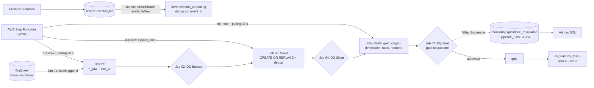

# Tech Challenge Fase 2 — Pipeline híbrido para análise da alfabetização no Brasil

Pipeline em arquitetura medalhão (Bronze → Silver → Gold) sobre o dataset `br_inep_avaliacao_alfabetizacao` da Base dos Dados.
A ingestão batch lê o BigQuery, o processamento roda no **Databricks (serverless) na AWS**, a orquestração é feita pelo **AWS Step Functions**,
e há um fluxo de **streaming simulado**, qualidade de dados com bloqueio, monitoramento em tabelas, alertas SQL e estimativa de custos com números medidos.

**Vídeo executivo:** _[[Assistir à apresentação](https://1drv.ms/v/c/715d858f67e5d4eb/IQA7nVkr0M6WRYMxIhmReAXwAWhSSwxnS0-rq_mGZ1j5gCk?e=9gke9O)]_

**Legenda:** ✅ implementado e executado, com evidência neste repositório · 🟡 escrito, mas **não implantado** · 🔭 evolução futura.

---

## 1. Contexto do problema

O Compromisso Nacional Criança Alfabetizada quer que todas as crianças brasileiras estejam alfabetizadas ao fim do 2º ano do ensino fundamental.
A Pesquisa Alfabetiza Brasil (INEP, 2023) definiu o ponto de corte de 743 pontos na escala do Saeb, e dele nasceu o Indicador Criança Alfabetizada:
o percentual de estudantes que atinge esse patamar. As metas (2024 a 2030) e os resultados são publicados por município, UF e país, em tabelas separadas,
além dos microdados dos alunos.

O pipeline integra as seis entidades do dataset (alunos, município, UF, meta Brasil, meta UF e meta município, mais o dicionário oficial)
para responder: **onde o resultado está acima ou abaixo da meta, e com que confiança esse número foi produzido.**

**Duas leituras da meta de 2030.** A fonte traz uma trajetória *pactuada* (valores anuais de 2024 a 2030) e, para a rede pública, a coluna
`meta_alfabetizacao_2030` com valor 80, que é a aspiração de universalização. Este projeto compara resultados **somente com a meta pactuada da fonte**.
Qualquer leitura de universalização deve ser apresentada como cenário.

## 2. Arquitetura



O diagrama mostra o que está implantado. O aviso imediato de falha da Step Functions (EventBridge + SNS, `orquestracao/alerta_falha.cfn.yaml`) está marcado 🟡: o arquivo é válido, mas não foi implantado.

**Jobs do Databricks** (definições em `orquestracao/jobs/`):

| Job | Conteúdo |
|---|---|
| 01 — Ingestão Bronze | 9 ingestões do BigQuery (6 entidades + dicionário + 2 diretórios) |
| 02 — Qualidade Bronze | validação da Bronze |
| 03 — Tratamento Silver | tratamento, dicionário oficial, diretórios |
| 04 — Qualidade Silver | validação da Silver |
| 05 — Dimensões Gold | dimensões em `gold_staging` |
| 06 — Fatos Gold | fatos, features, alertas |
| 07 — Qualidade Gold | DQ Gold, promoção, validação cruzada, FinOps, alertas |
| 08 — Streaming simulado | fora da Step Functions; rodado manualmente |
| 09 — Teste de falha de DQ | demonstração manual de bloqueio |

## 3. Tecnologias e justificativa

| Tecnologia | Uso | Por que | Status |
|---|---|---|---|
| Databricks serverless + Delta Lake | processamento, tabelas das camadas | Delta dá transações e histórico; serverless evita gerenciar cluster e cobra por uso | ✅ |
| Unity Catalog (`workspace`) | schemas `bronze`, `silver`, `gold`, `gold_staging`, `monitoring` | governança e permissões por schema | ✅ |
| BigQuery (Base dos Dados) | fonte oficial | tabelas nativas, sem necessidade de manter cópia local dos arquivos | ✅ |
| AWS Step Functions | orquestração dos 7 Jobs com dependência e falha propagada | máquina pai (Map, 1 por vez) + filha (dispara o Job e consulta o resultado) | ✅ executada |
| Databricks SQL Alerts | alertas sobre tabelas de monitoramento | usa as mesmas tabelas que a equipe já consulta | ✅ (5 alertas) |
| EventBridge + SNS (CloudFormation) | aviso imediato de falha da execução | reduz o tempo de descoberta de falha | 🟡 não implantado |
| Python + PySpark, `pytest` | transformações e 8 testes de regras puras (`src/tc_core.py`) | regras testáveis fora do Spark | ✅ |
| Modelo preditivo | Fase 3 | usa `gold.ds_features_fase3` | 🔭 |

## 4. Decisões arquiteturais

**Forma de acesso à fonte: BigQuery em vez de download de arquivos.**
- *Por que:* a plataforma oferece as duas formas e as duas são aceitas. Escolhemos o BigQuery porque o dado é atualizado na origem e a leitura direta evita manter uma cópia manual.
- *Custo:* o BigQuery cobra por bytes lidos (US$ 6,25 por TiB, com 1 TiB por mês gratuito). Medimos com *dry run*: uma carga completa lê **0,254 GiB** (a tabela `alunos` responde por 256 MiB), cerca de 7,6 GiB por mês com carga diária, dentro da franquia gratuita. A consulta tem limite de segurança de 20 GB (`maximum_bytes_billed`).
- *Transferência entre nuvens:* a fonte está no Google Cloud e o processamento na AWS. Os dados trafegam do Google para o Databricks. O egress da origem é cobrado por quem mantém o dataset; esse item não foi medido e não está na estimativa de custo; deve ser medido em produção.
- *Quando a fonte é atualizada:* cada execução faz um novo *snapshot* completo, grava na Bronze com novo `lote_id` e a Silver é reconstruída a partir da Bronze, deduplicando entre as cargas acumuladas, e o histórico das cargas fica na Bronze.

**Multi-cloud (Google + AWS): decisão consciente e seus custos.** A fonte vive no Google; o projeto roda na AWS por exigência de ambiente. Isso traz: egress de dados, **duas contas de billing** para conciliar (Databricks e AWS cobram separadamente, e a Google cobra o BigQuery), **dois modelos de identidade** (conta de serviço do Google guardada em Databricks Secrets e papéis da AWS) e a necessidade de a equipe dominar dois ecossistemas. Não tratamos isso como vantagem: foi o preço de usar a fonte oficial nativa.

**Batch versus streaming.** O batch carrega o histórico completo, periodicamente, com latência de minutos e reprocessamento simples. O streaming trata eventos incrementais com latência de segundos e garantia *pelo menos uma vez*, o que exige tratar reentrega e evento inválido. A comparação medida está na seção 6.

**Data lake versus data warehouse.** Usamos tabelas Delta sobre armazenamento de objetos (lakehouse): a Bronze é bruta e preserva histórico; a Gold tem esquema estável para consumo. Evitamos um warehouse separado para não duplicar armazenamento.

**Custo versus desempenho.** Serverless cobra por uso e simplifica a operação; ao custo de menos controle sobre o hardware (o primeiro lote do streaming leva ~31 s por partida a frio, ver seção 6).

**Política de escrita e histórico.**
- *Bronze:* `append` com `lote_id` e `data_ingestao`. Uma execução não apaga a anterior. Existe um parâmetro opcional de retenção por número de lotes; por padrão **todo o histórico é mantido**.
- *Silver:* `CREATE OR REPLACE TABLE`, reconstruída a partir da Bronze com deduplicação. É um estado derivado, não histórico.
- *Gold:* construída em `gold_staging`, passa pelo gate de qualidade e só então é copiada para `gold`.

**Limiar de correspondência de joins: 95%.** É uma escolha deste projeto, não uma regra do INEP. Ele é alto o suficiente para barrar uma perda relevante de linhas (na demonstração de falha, a correspondência caiu para 83,4% e foi bloqueada) e deixa margem para pequenas lacunas reais da fonte. Está parametrizado em widget e foi aprovado nas execuções reais (`qualidade_resultados`).

**Estados da meta.** Cinco estados explícitos em `dim_situacao_meta`: `ATINGIU_OU_SUPEROU`, `ABAIXO_DA_META`, `SEM_META`, `SEM_RESULTADO`, `SEM_META_DISPONIVEL_PARA_COMPARACAO`. Nulo nunca vira zero. Meta da UF é comparada **somente com o resultado da rede pública**, identificada pelo dicionário.

**Taxa ponderada.** `Σ peso dos alfabetizados ÷ Σ peso dos avaliados`, com `presenca = '1'` e `alfabetizado = '1'`, códigos confirmados no dicionário (`ft_taxa_alfabetizacao_ponderada`). Média simples entre municípios não é usada como indicador nacional.

## 5. Qualidade de dados

Todas as regras são classificadas como **bloqueantes** ou **informativas** e gravadas em `monitoring.qualidade_resultados` (que sobrevive ao fim da execução).

| Camada | Regra | Severidade |
|---|---|---|
| Todas | chave nula / duplicada | bloqueante |
| Silver | código fora do dicionário | bloqueante |
| Silver | correspondência de joins (município×meta, alunos×município, UF pública×meta) | bloqueante, limiar 95% |
| Gold | correspondência fato×dimensão, situação da meta inválida, taxa fora de [0, 100] (tolerância de 1e-6) | bloqueante |
| Gold | meta nula, divergência da taxa oficial | informativa |

O `RegistroDQ` grava todos os resultados e **depois** levanta a exceção, e a falha também é registrada em `pipeline_runs`. A promoção para a Gold depende do sucesso do gate (`ALL_SUCCESS`).

**Demonstração de falha (Job 09, camada `GOLD_DEMO`).** Em um schema separado (`gold_staging_demo`), injetamos linhas com chave duplicada e 200 linhas com um município inexistente. O gate bloqueou como esperado:

| Regra | Severidade | Resultado | Detalhe |
|---|---|---|---|
| `TAXA_CORRESPONDENCIA_JOIN` | bloqueante | FALHOU | 83,4% (1.005 de 1.205); limiar 95%; 200 sem par |
| `CHAVE_DUPLICADA` | bloqueante | FALHOU | 8 linhas |
| `CHAVE_NULA` | bloqueante | PASSOU | 0 linhas |

**Validação cruzada com o indicador oficial.** Recalculamos a taxa a partir dos microdados (ponderada) e comparamos com a taxa publicada: **12.351 de 12.408 recortes (99,5%)** ficam dentro de 1 ponto percentual. Os 57 que divergem são registrados como informativos. Em um caso investigado, os microdados indicaram 55,6% e a taxa publicada foi 91,67%; a diferença foi localizada entre as tabelas da fonte e **a causa não foi identificada**. Também verificamos o município 2305100: a Silver tem 72 alunos e a Bronze acumula 648 linhas (9 cargas × 72), o que mostra que a duplicidade entre cargas é absorvida pela deduplicação da Silver. A convergência de 99,5% é a evidência mais forte que o dataset permite de que as etapas anteriores estão corretas.

**Correspondência na Silver (limiar 95%):** município × meta municipal 97,78%, alunos × município 99,95% e UF × meta estadual 100%. Achados informativos: 242 municípios sem meta municipal e 3.209 registros de alunos sem município. Na Gold, os quatro relacionamentos fato-dimensão testados tiveram 100% de correspondência, com 1.185 registros presentes sem peso amostral (informativo).

**Anomalias conhecidas na Gold:** 216 linhas municipais, 1 linha de UF e 1 do Brasil sem meta cadastrada, mantidas como `SEM_META` (informativo `META_NULA`).

## 6. Streaming (simulado)

- **Mecanismo:** um produtor grava eventos na tabela-fila `bronze.eventos_fila`, incluindo defeitos e reentregas. O consumidor lê com `foreachBatch` e `availableNow`, em micro-lotes.
- **Tratamento:** valida (taxa nula, negativa ou acima de 100, rede desconhecida), registra o motivo, deduplica entre lotes por `event_id` (`MERGE`) e publica em `silver.eventos_streaming` e `gold.ft_indicador_streaming`. Todo dado simulado tem `origem = 'SIMULADO'` e nunca se mistura ao indicador oficial sem identificação.
- **Latência:** `processing_time` (carimbo do consumidor) menos `event_time` (carimbo do produtor), medida de fato.
- **Execução medida (Job 08, 5 ciclos de 20 eventos):** 130 eventos recebidos (30 reentregas), 94 eventos únicos na Silver, 8 inválidos descartados (3 taxa nula, 3 negativa, 1 acima de 100, 1 rede desconhecida). Latência: **média 12,6 s, mínima 7,6 s, máxima 31,6 s** (o primeiro lote levou ~31 s por partida a frio; os demais, cerca de 8 s). As métricas ficam em `monitoring.streaming_runs`.
- **Diferença para o batch:** o batch tem latência de minutos (os 41 passos levaram 21 min), é completo e reprocessável. O streaming tem latência de segundos, é incremental e entrega *pelo menos uma vez*, por isso exige deduplicação.
- **Limite:** a fonte é simulada, e a espera de transporte entre produtor e consumidor também. A latência medida inclui essa espera simulada e **não representa uma fonte real**.

## 7. Monitoramento e FinOps

**Monitoramento.** Cada etapa grava em `monitoring.pipeline_runs`, de forma cumulativa, duração, linhas e status (`SUCESSO` ou `FALHA`). Na execução de 26/10/2026 foram 41 registros, todos `SUCESSO`. Os alertas SQL (`Monitoring/alertas_sql.sql`) cobrem falha de qualidade, `FALHA` em `pipeline_runs`, variação anormal de volume, SLA de execução e latência de streaming.

**Em produção, quem descobre que o pipeline quebrou, e em quanto tempo?** A Step Functions marca a execução como falha e interrompe os Jobs seguintes. Hoje a descoberta é pelos alertas SQL, avaliados periodicamente, em até cerca de uma hora (destino de notificação: _[CONFIRMAR o e-mail ou canal configurado nos alertas]_). O aviso imediato por EventBridge + SNS está 🟡 planejado: a conta de laboratório da AWS usada tem política de negação explícita que impediu a implantação.

**Estimativa de custo mensal** (`monitoring.finops_projecao_mensal`), com quantidades medidas e 30 execuções por mês:

| Serviço | Unidade | Quantidade medida (mensal) | Preço unitário (US$) | Custo mensal projetado (US$) |
|---|---|---|---|---|
| Databricks serverless (Jobs) | DBU | 109,08 (3,636 por execução completa) | 0,35 | 38,18 |
| BigQuery (on-demand) | TiB lido | 0,0074 (0,254 GiB por carga) | 6,25 | 0,05 (teórico; dentro da franquia gratuita de 1 TiB, custo efetivo 0) |
| AWS Step Functions (Standard) | 1.000 transições | 4,26 (142 por execução) | 0,025 | 0,11 |
| **Total** | | | | **38,33** |

Fontes das medições: cobrança do Databricks (`system.billing.usage` junto com `system.lakeflow.job_run_timeline`, somando só os 7 Jobs da execução limpa), *dry run* do BigQuery e métricas de transição da Step Functions. O preço do DBU vem de `system.billing.list_prices` (SKU de Jobs serverless, US East Ohio). Preço do BigQuery e da Step Functions: tabelas públicas dos provedores.
**Ressalvas:** o ambiente AWS é de laboratório educacional, então o custo real de AWS no laboratório é zero; a tabela projeta o mesmo desenho em produção com execução diária. Egress entre nuvens e armazenamento não estão incluídos.

**Otimização aplicada.** Formato Delta/Parquet; `SELECT *` limitado por `maximum_bytes_billed`; Silver reconstruída a partir da Bronze (sem reler a fonte); uma carga por Job.

## 8. Aplicação em IA

A Gold alimenta `gold.ds_features_fase3`: uma linha por município, série, rede e ano **T**, com alvo `alvo_atingiu_meta_t` (1 se atingiu a meta, 0 se ficou abaixo).
- **Sem vazamento do alvo:** todas as variáveis vêm de **T-1 ou antes** (taxa, meta, diferença para a meta, média de português, proporção de alunos em níveis baixos), e o alvo só vem de T. A tabela não carrega o alvo nem coluna derivada dele. Anos sem T-1 ficam de fora. Só entram linhas `ATINGIU_OU_SUPEROU` ou `ABAIXO_DA_META`; sem meta não vira zero.
- **Usos possíveis:** apontar municípios com risco de ficar abaixo da meta, analisar desigualdades por UF e região, e apoiar políticas públicas baseadas em evidências.
- **Cuidado:** com poucos anos de série, qualquer projeção até 2030 é **cenário, não previsão**. O modelo em si é a Fase 3 (🔭).

## 9. Limitações conhecidas

- O streaming é **simulado**; a latência medida inclui a espera simulada de transporte.
- O aviso imediato de falha (EventBridge + SNS) não foi implantado 🟡 (restrição do laboratório); a descoberta de falha é por alertas SQL periódicos.
- A estimativa de custo projeta execução diária e não inclui egress entre nuvens nem armazenamento.
- 57 recortes (0,5%) divergem da taxa oficial acima de 1 p.p.; a causa não foi identificada.
- Há linhas sem meta cadastrada (216 municipais, 1 UF, 1 Brasil), mantidas como `SEM_META`.
- Os testes automatizados cobrem as regras puras em `src/tc_core.py`, não as notebooks.
- Os testes locais usaram Parquet no lugar de Delta; a execução real foi no Databricks.

## 10. Como executar

**Requisitos:** workspace Databricks (serverless) com Unity Catalog, projeto GCP com acesso de leitura ao BigQuery, Python 3.10+ para os testes (`pip install -r requirements.txt`).

1. **Credencial GCP (nunca versionada).** Crie uma conta de serviço com os papéis *Usuário de jobs do BigQuery* e *Usuário de sessão de leitura do BigQuery*, gere uma chave JSON e guarde no Databricks Secrets:
   - escopo `tech-challenge`, chave `gcp-sa-json` (o JSON completo);
   - escopo `tech-challenge`, chave `gcp-project` (o ID do projeto GCP que paga as consultas).
   Alternativas: variável de ambiente `GCP_PROJECT` ou `spark.conf` `tc.gcp_project`, e `GCP_CREDENTIALS_PATH` para um arquivo fora do repositório.
2. **Importar** a pasta `Arquitetura_TechChallenge` para o workspace. Os caminhos dos notebooks nos YAMLs de `orquestracao/jobs/` assumem `/Workspace/Users/<seu-usuário>/Arquitetura_TechChallenge/...`; ajuste para o seu usuário.
3. **Criar os Jobs 01 a 09** a partir de `orquestracao/jobs/*.yml` (ver `orquestracao/jobs/LEIA-ME.md`).
4. **Parâmetros do FinOps (task FINOPS do Job 07):** `dbu_por_execucao`, `bq_gib_por_execucao`, `execucoes_mes`, `preco_dbu_usd`, `preco_sfn_1k_transicoes_usd`, `preco_bq_tb_usd` e `fonte_precos`. Preços não preenchidos resultam em custo NULO, nunca zero.
5. **Orquestração AWS:** crie as duas state machines com `orquestracao/state_machine_*.asl.json`, substitua os IDs em `orquestracao/input_execucao.json` pelos IDs dos seus Jobs e execute a pai com esse arquivo como entrada. A conexão HTTP com a API do Databricks usa o token como secret da conexão.
6. **Testes:** `pytest tests/` (8 testes).
7. **Demonstrações:** rode o Job 08 (streaming) e o Job 09 (falha de DQ), e consulte `monitoring.streaming_runs` e `monitoring.qualidade_resultados`.

## 11. Evidências de execução

Execução completa pela Step Functions em 26/10/2026, 19:35:59 a 19:57:00 (21 min 02 s), com 41 etapas registradas em `pipeline_runs`, todas `SUCESSO`. Cobrança por Job (DBU):

| Job | job_id | run_id | DBU |
|---|---|---|---|
| 01 — Ingestão Bronze | 406583319406367 | 995026929875823 | 0,739 |
| 02 — Qualidade Bronze | 515736054772058 | 488305297674131 | 0,416 |
| 03 — Tratamento Silver | 1057627853630929 | 302173144504174 | 0,905 |
| 04 — Qualidade Silver | 1692178614333 | 270970517464390 | 0,458 |
| 05 — Dimensões Gold | 544751070187297 | 399956631056623 | 0,207 |
| 06 — Fatos Gold | 484293251298664 | 907426707559673 | 0,352 |
| 07 — Qualidade Gold | 395294127289096 | 1030141907948909 | 0,559 |
| **Total** | | | **3,636** |

Outras evidências: streaming (Job 08, `monitoring.streaming_runs`), demonstração de falha (Job 09, run 1115356732998681, `qualidade_resultados` camada `GOLD_DEMO`), validação cruzada (12.351 de 12.408), 142 transições da Step Functions por execução e 0,254 GiB lidos do BigQuery por carga.

## 12. Estrutura do repositório

```
Bronze/Ingestão/            01–09 + _common_ingestao
Bronze/Qualidade_dados/     01_validar_qualidade_bronze
Bronze/Streaming/           01_simulacao_streaming
Silver/Tratamento/          01–06
Silver/Dimensoes/           01_dicionario_oficial · 02_diretorio_municipio · 03_diretorio_uf
Silver/Qualidade_dados/     01_validar_qualidade_silver
Gold/Dimensoes/ · Fato/ · Features/
Gold/Qualidade_dados/       01_validar · 02_teste_falha_dq_demo · 03_promover_gold · 04_validacao_cruzada_taxa
Gold/FinOps/                01_finops_custos
Monitoring/                 _common_monitoring.py · alertas_sql.sql
orquestracao/               state machines · input_execucao.json · alerta_falha.cfn.yaml · jobs/
src/tc_core.py · tests/     regras puras e 8 testes
```
